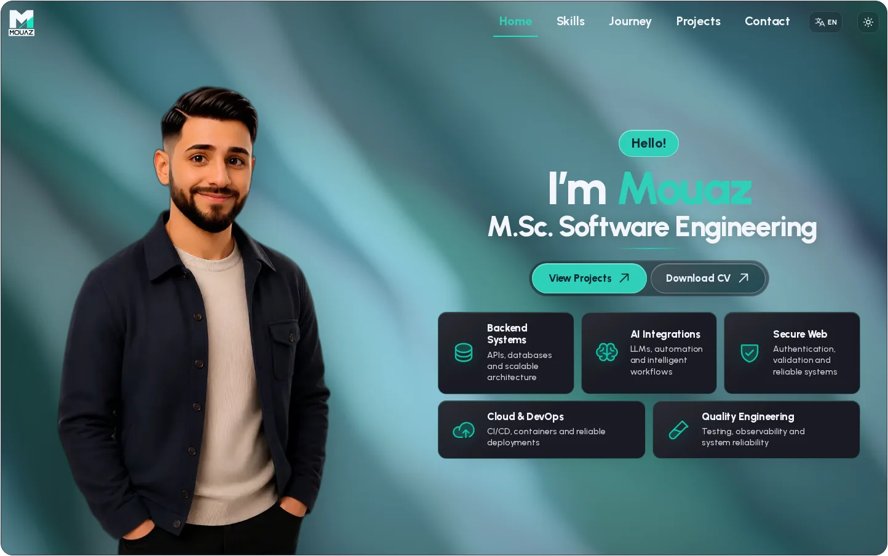
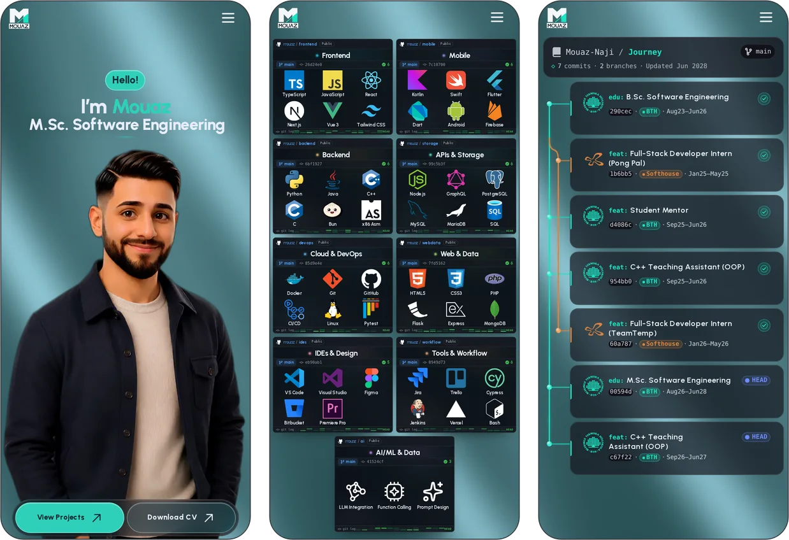

<p align="center">
  <a href="https://mouazdev.vercel.app">
    
  </a>
</p>

<h1 align="center">Mouaz Naji — Developer Portfolio</h1>

<p align="center">
  <strong>Projects, skills and experience, presented as a GitHub-style developer workspace.</strong><br />
  English · Svenska · العربية &nbsp;—&nbsp; light and dark &nbsp;—&nbsp; phone, tablet and desktop
</p>

<p align="center">
  <a href="https://mouazdev.vercel.app"></a>
</p>

<p align="center">
  <a href="https://github.com/Mouaz7/portfolio-/actions/workflows/ci-cd.yml"></a>
  <a href="https://github.com/Mouaz7/portfolio-/actions/workflows/codeql.yml"></a>
  
  
  
  
  
</p>

<p align="center">
  <a href="#-features">Features</a> ·
  <a href="#-pages">Pages</a> ·
  <a href="#-tech-stack">Tech stack</a> ·
  <a href="#-getting-started">Getting started</a> ·
  <a href="#-scripts">Scripts</a> ·
  <a href="#-documentation">Documentation</a>
</p>

<p align="center">
  <a href="https://mouazdev.vercel.app">
    <picture>
      <source media="(prefers-color-scheme: dark)" srcset="docs/assets/home-desktop-dark.webp" />
      <source media="(prefers-color-scheme: light)" srcset="docs/assets/home-desktop-light.webp" />
      
    </picture>
  </a>
</p>

---

## 👋 About

This is the source of my personal website. It shows who I am, what I work
with, where I have studied and worked, and the projects I have built.

It is built with Next.js and Supabase, runs on Vercel, and is designed to work
everywhere: new and old browsers, fast and slow devices, in three languages.

## ✨ Features

<table>
  <tr>
    <td width="50%" valign="top">
      <h3>🌊 Smooth on every device</h3>
      A shared WebGL ocean background at 60 fps. Desktops render it in a Web
      Worker, phones use their own wave shader, devices without GPU
      acceleration get a lighter crossfade, and anything unsupported falls back
      to CSS.
    </td>
    <td width="50%" valign="top">
      <h3>🌍 Three languages</h3>
      English, Swedish and Arabic with a right-to-left layout, plus light and
      dark mode and layouts tuned for phones, tablets and desktops.
    </td>
  </tr>
  <tr>
    <td valign="top">
      <h3>🕰️ Works on old browsers</h3>
      Browsers older than Chrome 105, Firefox 115 or Safari 15.4 get a simple,
      readable version instead of a broken page. Generated legacy CSS and
      PostCSS fallbacks cover older CSS engines.
    </td>
    <td valign="top">
      <h3>⚡ Server-first</h3>
      Pages preload their content from Supabase on the server with cached,
      locale-aware loaders, and only fetch in the browser if that fails.
    </td>
  </tr>
  <tr>
    <td valign="top">
      <h3>🔒 Secure</h3>
      A strict per-request Content Security Policy, hardened HTTP headers, rate
      limits, optional Cloudflare Turnstile on the contact form and fail-closed
      checks of server secrets.
    </td>
    <td valign="top">
      <h3>🛡️ Respects privacy</h3>
      Errors are reported anonymously (cleaned message, page path, browser
      family) to the server log only. Reports contain no IP address, read no
      cookies and are never stored in a database.
      See the <a href="https://mouazdev.vercel.app/privacy">privacy page</a>.
    </td>
  </tr>
  <tr>
    <td valign="top">
      <h3>♿ Accessible</h3>
      Automated axe checks, keyboard focus handling, reduced motion,
      forced-colors mode and 400 % reflow are all tested.
    </td>
    <td valign="top">
      <h3>✅ Thoroughly tested</h3>
      Jest unit tests, Playwright in Chromium, Firefox and WebKit,
      pixel-locked screenshots, Lighthouse budgets and database policy tests run
      on every pull request.
    </td>
  </tr>
</table>

## 📱 Pages

<p align="center">
  <picture>
    <source media="(prefers-color-scheme: dark)" srcset="docs/assets/mobile-pages-dark.webp" />
    <source media="(prefers-color-scheme: light)" srcset="docs/assets/mobile-pages-light.webp" />
    
  </picture>
  <br />
  <sub>Home, Skills and Journey on a phone</sub>
</p>

| Page | What you'll find |
| :-- | :-- |
| 🏠 **[Home](https://mouazdev.vercel.app)** | Introduction, roles, capabilities and a CV download. |
| 🧰 **[Skills](https://mouazdev.vercel.app/skills)** | Technologies grouped as repository cards. |
| 🧭 **[Journey](https://mouazdev.vercel.app/journey)** | Education and experience on a Git commit graph. |
| 📦 **[Projects](https://mouazdev.vercel.app/projects)** | GitHub repositories with search, filters and live stats. |
| ✉️ **[Contact](https://mouazdev.vercel.app/contact)** | A contact form styled as a commit, plus social links. |
| 🔐 **[Privacy](https://mouazdev.vercel.app/privacy)** | What the site collects and why. |

## 🧱 Tech stack

| | Technology |
| :-- | :-- |
| **Framework** | [Next.js 16](https://nextjs.org) (App Router) · [React 19](https://react.dev) · [TypeScript 5.9](https://www.typescriptlang.org) |
| **Styling** | [Tailwind CSS 4](https://tailwindcss.com) · CSS variables · CSS Modules |
| **Data** | [Supabase](https://supabase.com) — Postgres with row-level security and private Storage |
| **Email** | [Nodemailer](https://nodemailer.com) over SMTP |
| **Hosting** | [Vercel](https://vercel.com) · Web Analytics · Speed Insights |
| **Testing** | [Jest](https://jestjs.io) · [React Testing Library](https://testing-library.com) · [Playwright](https://playwright.dev) with axe · [pgTAP](https://pgtap.org) |
| **Tooling** | ESLint · Knip · GitHub Actions · Dependabot · CodeQL · Gitleaks |

## 🚀 Getting started

**You need** [Node.js 22.x](https://nodejs.org) and npm.

```bash
# 1. Clone and install
git clone https://github.com/Mouaz7/portfolio-.git
cd portfolio-
npm ci

# 2. Create your local settings, then fill in the values
cp .env.example .env.local

# 3. Start the development server
npm run dev
```

Open **[localhost:3000](http://localhost:3000)** once the terminal prints
`Public pages ready`.

> [!TIP]
> [`.env.example`](.env.example) explains every variable. The pages need a
> Supabase project and the contact form needs SMTP credentials. To use a local
> database instead, run `supabase start` and `supabase db reset` with the
> Supabase CLI; this applies `supabase/migrations` and `supabase/seed.sql`.

## 🧪 Scripts

| Command | What it does |
| :-- | :-- |
| `npm run dev` | Development server on port 3000. |
| `npm run verify` | Lint, types, unused code, design lock and unit tests. **Run before every push.** |
| `npm run verify:full` | `verify`, then the production build and the browser tests. |
| `npm run build` | Production build (generates the legacy CSS first). |
| `npm start` | Serve the production build. |
| `npm run test:ci` | Unit tests with coverage thresholds. |
| `npm run test:e2e` | Playwright browser tests — build first, see the [testing guide](docs/testing-guide.md). |
| `npm run sync:projects` | Import new public GitHub repositories into Supabase. |

## 🗂️ Project structure

<details>
<summary>Show the folder layout</summary>

```text
.
├── app/              Routes, page shells, API route handlers, metadata and CSS
├── components/       UI components by feature (home, skills, journey, project, contact, …)
├── hooks/            Shared browser hooks (viewport fitting, media queries)
├── lib/              Server loaders, i18n, security, contact, projects and caching
│   ├── background/   WebGL ocean renderer, worker and fallbacks
│   └── telemetry/    Anonymous error reports
├── postcss/          CSS fallbacks for older browsers
├── tooling/          Build loader that lowers newer syntax for older Safari/iOS
├── scripts/          Dev server, project sync, design/pixel locks, performance and security checks
├── supabase/         Migrations, seed data, local config and database tests
├── __tests__/        Jest unit tests
├── tests/e2e/        Playwright browser tests
├── docs/             Maintainer documentation
├── public/           Static assets (brand, icons, images)
└── proxy.ts          Locale routing and the per-request Content Security Policy
```

</details>

## ☁️ Deployment

| | |
| :-- | :-- |
| **Hosting** | Vercel, in the Dublin region next to the database |
| **Production** | Every merge into `main` |
| **Previews** | One per pull request |
| **Checks** | GitHub Actions: quality, security and database tests on every pull request and every push to `main` |
| **Updates** | Dependabot proposes dependency updates every week |

Full details: [Deployment and CI](docs/deployment.md).

## 📚 Documentation

| Document | Read it for |
| :-- | :-- |
| 🏗️ [Architecture](docs/architecture.md) | Routing, languages, rendering, the background, styling, data flow and API routes |
| 🗄️ [Database](docs/database.md) | Supabase tables, migrations, translations, the private CV and caching |
| ☁️ [Deployment and CI](docs/deployment.md) | Environment variables, Vercel, post-deploy checks and GitHub Actions |
| 🧪 [Testing guide](docs/testing-guide.md) | Jest, Playwright, design and pixel locks, visual and performance checks |
| 🔒 [Security](docs/security.md) | Content Security Policy, attachments, secret scanning and licenses |
| 🛡️ [Privacy data inventory](docs/privacy-data-inventory.md) | Every piece of data the site handles — the source for `/privacy` |

All documents are listed in the [documentation hub](docs/README.md). To report
a vulnerability, see the [security policy](.github/SECURITY.md).

## 📄 License

Copyright © 2026 Mouaz Naji. All rights reserved.

- **Source code** — publicly visible, but **not open source**. See [LICENSE](LICENSE).
- **Personal and brand assets** — covered by [ASSETS_LICENSE.md](ASSETS_LICENSE.md).
- **Third-party libraries, fonts and icons** — keep their own licenses, listed in [THIRD_PARTY_NOTICES.md](THIRD_PARTY_NOTICES.md).

---

<p align="center">
  <sub>
    Built by <a href="https://github.com/Mouaz7"><strong>Mouaz Naji</strong></a> ·
    <a href="https://mouazdev.vercel.app">mouazdev.vercel.app</a> ·
    <a href="https://mouazdev.vercel.app/contact">Get in touch</a>
  </sub>
</p>
