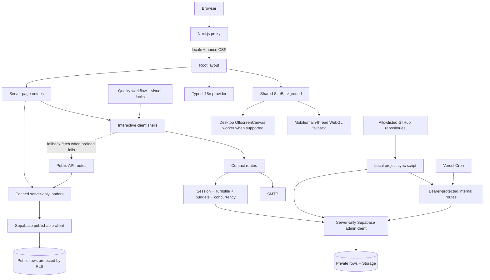
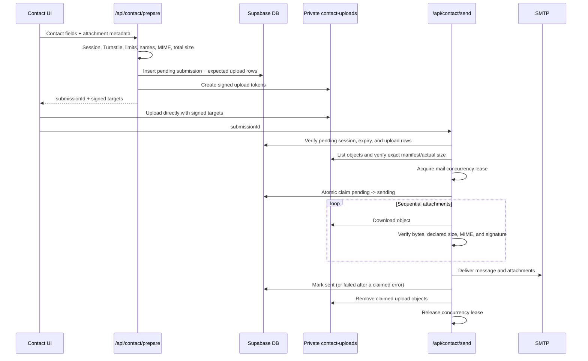

# Architecture

This portfolio is a Next.js 16 App Router application that combines server-first page rendering with interactive client presentation. Supabase provides public content, row-level security, private file storage, and distributed request budgets. Server-only route handlers integrate SMTP, GitHub-derived data, and protected automation.

The UI is one responsive GitHub/Git-inspired workspace across Home, Skills, Journey, Projects, and Contact. Source design locks and 30 screenshot signatures check that presentation; a failing lock still needs manual review.

## System overview



## Request lifecycle

### 1. Proxy and localization

`proxy.ts` runs for public page requests and most same-origin public asset paths. Its matcher excludes API routes and Next.js static/image endpoints. It has two responsibilities:

1. Generate a request nonce and attach a Content Security Policy to the request and response.
2. Resolve English, Swedish, or Arabic routing before the App Router renders.

English is canonical and unprefixed. `/en/...` redirects permanently to the matching unprefixed route. Swedish and Arabic use `/sv/...` and `/ar/...`; the request proxy rewrites those paths to the shared App Router page and passes the locale in `x-locale`. A first visit to `/` can redirect to the browser or saved preferred locale. The language choice is stored in a one-year `SameSite=Lax` cookie.

The root layout loads one typed dictionary, sets document `lang` and `dir`, and mounts `I18nProvider`. UI labels live in versioned TypeScript dictionaries. Editable page content uses the `content_translation` table with English/source fallback. Metadata, canonical URLs, `hreflang` alternatives, Open Graph locale, robots data, and sitemap entries are produced server-side.

Why it is built this way:

- Static dictionaries keep navigation and controls available without a database round trip, so UI rendering never waits for Supabase.
- URL locales make links shareable and indexable; proxy rewrites reuse one set of page components.
- One small translation table avoids duplicating project and Journey rows and allows content edits without a deployment. The trade-off is less strict typing (validated JSON fields), and newly synced projects show English until their `sv`/`ar` rows are added.
- Adding a language requires a dictionary, a locale config entry and a migration that extends the database locale constraint.

### 2. Root layout and global platform concerns

`app/layout.tsx` owns:

- localized global metadata and canonical site identity;
- the self-hosted Urbanist font;
- the nonce-bearing inline head scripts (`lib/security/inline-scripts.cjs`): the modern-syntax probe and simple-mode detection for old browsers, theme initialization, browser-extension compatibility and the performance tier;
- the shared `SiteBackground` behind every route;
- `ErrorReporter`, which sends anonymous reports of uncaught errors (see `/privacy`);
- the typed localization provider;
- Vercel Analytics and Speed Insights only when running on Vercel.

The document uses a fixed viewport shell. Each page owns its internal responsive composition and scroll behavior rather than allowing accidental body overflow.

### 3. Server-first page rendering

Page entries preload localized data directly through server-only loaders. They do not call their own public HTTP APIs during a successful server render.

| Page | Server preload | Client fallback |
| --- | --- | --- |
| Home | `getHomeContent(locale)` | None: Home falls back to the bundled default copy. |
| Skills | `getSkillCategories(locale)`, `getSkills()` and `getProjects(locale)` (links skills to their projects) | `/api/skill-categories?locale=...` and `/api/skills`. |
| Journey | `getJourney(locale)` plus request-derived initial mobile mode | `/api/journey?locale=...`. |
| Projects | `getProjects(locale)` + GitHub repository stats (1.5 s budget) | `/api/project?locale=...`; repository counters load in the browser only when the server could not get them in time. |
| Contact | `getContactLinks()` | `/api/contact`. |

When server data is present, Skills, Journey, and Projects render it without a second primary-data request or a minimum loading duration. If preload fails, the client performs a real fallback fetch and shows `PageLoadingStage` while that request is pending.

The visible shells remain client components where animation, input, filters, and viewport state are required. DTO shaping, URL validation, localization joins, and cached queries remain server-only.

## App Router map

| Canonical route | Entry | Responsibility |
| --- | --- | --- |
| `/` | `app/page.tsx` | Localized Home content and interactive profile stage. |
| `/skills` | `app/skills/page.tsx` | Connected repository-style Skills grid. |
| `/journey` | `app/journey/page.tsx` | Git commit graph for education and experience. |
| `/projects` | `app/projects/page.tsx` | Searchable GitHub-style repository catalog. |
| `/contact` | `app/contact/page.tsx` | Repository-style contact composer and social links. |
| `/privacy` | `app/privacy/page.tsx` | Privacy notice: what the site collects and why. |

Every canonical page also has Swedish and Arabic aliases through proxy rewriting, for example `/sv/projects` and `/ar/projects`. The legacy Skills, Projects and Contact `*-page` URLs redirect in the proxy, preserving locale and query parameters. Each canonical route directory owns its server entry and client shell; Contact also owns its page styles. There are no duplicate legacy page entries. Reusable hooks live under `hooks/`.

## Presentation architecture

### GitHub/Git workspace language

- Skills uses repository paths, branches, hashes, checks, contribution strips, `HEAD`, and graph connectors.
- Journey uses branch rails, commit prefixes, hashes, metadata, verified states, and a current head.
- Projects uses repository search, filters, visibility, languages, stars, and forks.
- Contact models a repository plus commit composer with changed files and clean working-tree states.

CSS variables in `app/global.css` define the shared theme. Page CSS and CSS Modules own exact responsive geometry. Presentation components and critical assets are protected by `scripts/check-design-lock.mjs`; browser screenshots are protected by `scripts/check-pixel-lock.mjs`.

### Theme and styling

`app/global.css` defines dark defaults on `:root` and light overrides on `html.light`; a pre-paint inline script restores the saved theme from `localStorage` to avoid a flash. Core tokens are `--bg`/`--fg`, `--accent`/`--accent-strong`, `--accent-2`, `--surface`/`--surface-2`, `--surface-border` and the `--skills-*` readability tokens. `tailwind.config.js` maps `text-white` to `var(--fg)`, `bg-black` to `var(--bg)`, `accent` and the legacy `cornflowerblue-*` names to the teal accent, so utility classes flip with the theme. Route-specific CSS lives in `app/styles/`, `app/home-page.module.css` and `app/contact/`.

Animation uses CSS transitions, keyframes and the shared canvas; Projects, Skills, Journey and Contact honour `prefers-reduced-motion`. Use the shared tokens rather than one-off colours, keep fixed-format stages at explicit dimensions with scaling, and do not add filler content to make a layout look full.

### Skills asset model

In browsers supporting CSS typed division, the server-rendered Skills grid fits the space below the actual header using container units before hydration. The initial CSS mirrors the measured layout's breakpoints and readability floor. Once React measures the viewport, the existing JavaScript fitting and resize handling take over. Unsupported engines retain that measured fallback. A delayed-script browser test compares the initial and hydrated geometry across layout profiles and locales.

Skills icons are vendored under `public/skill-icons`. `docs/skill-icon-sources.json` is both the source/license manifest and the application allowlist. `lib/skills/data.server.ts` resolves catalog entries to same-origin paths and rejects stale remote database URLs. Each source mark is rendered inside an equal clipped canvas with an optical correction; hover/touch transforms cannot escape the canvas or create shadows/collisions.

### Navigation and viewport fitting

The header uses Next.js links and explicitly prefetches a destination when its link receives pointer hover, keyboard focus, or touch intent. The development server separately warms the five main public routes during startup.

`RouteScrollNavigator` provides the portfolio's deliberate page-to-page wheel/swipe narrative. It accumulates vertical intent, applies a cooldown, prefetches before pushing, ignores interactive targets, and yields to any nested element that can still scroll in the requested direction. It installs no global keyboard shortcut and disables gesture enhancement for reduced-motion users. Mobile touch navigation can be disabled by page composition where it would conflict with interaction.

Reusable viewport-fit hooks measure the header and the layout viewport (the visual viewport with pinch-zoom undone, `lib/viewport/layout-viewport.ts`) at most once per animation frame, account for resize/orientation changes, and scale fixed design stages without changing their approved internal geometry. This is how dense Git-style canvases remain inside small screens without body overflow.

### Shared ocean background

`components/ui/SiteBackground.tsx` owns a single theme-aware WebGL canvas for all routes; the rendering code lives in `lib/background/` (`renderer.ts`, `shaders.ts`, `crossfade.ts`, `worker-host.ts`, `main-thread.ts`, `page-state.ts`, `profile.ts`):

- rendering is two-pass: the original shader fills small keyframes a few times per second and every displayed frame blends them at native resolution (60 fps);
- desktop moves rendering to a Web Worker with `OffscreenCanvas` when supported;
- mobile uses its own wave shader without thresholded bands to avoid GPU facets; desktops (including constrained ones) use the desktop shader;
- without usable GPU acceleration the compositor crossfade takes over (keyframes faded by the browser), and `html[data-render-mode="software"]` drops per-frame CPU effects (`app/styles/performance-tier.css`);
- unsupported worker/WebGL paths fail gracefully to the CSS background, and every fallback sends an anonymous report;
- resize and pointer updates are coalesced to one update per animation frame;
- hidden documents stop rendering;
- reduced-motion and performance-audit modes render a still frame;
- a dedicated worker performs the first completed GPU draw before reporting readiness.

This keeps background animation from blocking navigation and prevents desktop shader complexity from causing artifacts on mobile GPUs.

## Data architecture

### Supabase clients

- `lib/backend/supabaseClient.ts` uses the publishable key for RLS-protected public reads and connectivity checks.
- `lib/backend/supabaseAdminClient.ts` is server-only and uses `SUPABASE_SECRET_KEY` for privileged Contact, CV, sync, and cleanup operations.

The admin client must never be imported by a client component. Next.js `server-only` guards enforce that boundary in sensitive modules.

### Primary data domains

| Domain | Representative storage |
| --- | --- |
| Home | `site_profile`, `home_role`, `home_capability` |
| Skills | `skill_category`, `skill`; icons are same-origin static assets |
| Journey | `journey_item`; organization logos may use Storage-backed paths |
| Projects | `project` plus GitHub-derived repository metadata |
| Localization | `content_translation` for localized editable fields |
| Contact | `contact_social`, private `contact_submission`, `contact_upload`, and `contact-uploads` Storage |
| CV download | Private `private-cv` bucket with a configured PDF object |
| Protection | Request-budget/concurrency tables and RPCs installed by security migrations |

Migrations in `supabase/migrations` are the source of truth for schema and policy evolution. `supabase/seed.sql` supplies deterministic browser/visual-test content. `supabase/tests/security_policies.test.sql` verifies grants, RLS, Storage restrictions, and security RPC behavior against an isolated local database in CI.

### Caching and revalidation

Server loaders use `cachedLoader` (`lib/cached-loader.server.ts`), a wrapper around `unstable_cache` with a domain tag and locale-aware cache keys. Every key starts with `CACHE_VERSION`, so a deploy that changes it starts from fresh data. Tags and windows live in `lib/cache.ts`: `projects` and `home-content` 30 minutes, `skills` and `contact` 60 minutes, `journey` 120 minutes. Public JSON responses add bounded shared-cache headers where appropriate.

`/api/internal/revalidate` accepts only allowlisted tags and requires `REVALIDATE_SECRET`. After a project sync, call it with the `projects` tag (see [Deployment and CI](deployment.md#project-synchronization)). Private or mutable endpoints are dynamic and avoid shared caching.

In production, static assets under `brand`, `contact`, `home`, `journey`, `project-icons`, and `skill-icons` use a five-minute browser cache (`public, max-age=300, stale-while-revalidate=86400`). Development omits that policy so replaced images appear immediately. This affects static asset responses, not page or API caching.

## Public API boundaries

| Route | Method | Backend source or side effect |
| --- | --- | --- |
| `/api/skills` | GET | Cached active skills and same-origin icon paths. |
| `/api/skill-categories` | GET | Cached localized active categories. |
| `/api/journey` | GET | Cached localized Journey loader. |
| `/api/project` | GET | Cached localized public projects. |
| `/api/github/repo-stats` | POST | Validated live statistics for allowlisted GitHub repositories. |
| `/api/contact` | GET | Cached public contact/social links. |
| `/api/contact/prepare` | POST | Validate contact data/metadata, create pending rows, and issue signed upload targets. |
| `/api/contact/send` | POST | Verify, claim, download, send, update status, and clean uploaded objects. |
| `/api/cv` | GET | Validated private Storage PDF stream with HTTP validators. |
| `/api/health` | GET | Uncached shallow production-configuration health. |
| `/api/client-report` | POST | Anonymous error reports from the site's own pages; validated, rate-limited in memory and written to the server log only. |

API handlers validate body sizes before parsing and return controlled public errors. Sensitive implementation errors are logged server-side without echoing credentials.

## Contact transaction

Attachment upload is disabled by default and requires an explicitly configured malware scanner. When enabled, the browser never receives general Storage credentials; uploads use short-lived signed targets tied to one pending submission.



Allowed attachment families are PDF, PNG, JPG/JPEG, WebP, and TXT. Extra, missing, substituted, oversized, or signature-spoofed objects are rejected. A busy response occurs before the atomic claim, so the submission remains pending and can be retried. The claim RPC protects against concurrent delivery and replay.

## CV delivery

The public URL is stable at `/api/cv`, while the PDF itself lives in a private bucket at the exact object path configured by `CV_STORAGE_BUCKET` and `CV_STORAGE_OBJECT`. The current path is `private-cv/cv/Cv .pdf`.

The route:

1. resolves the configured bucket/object;
2. reads Storage metadata and downloads only that object through the admin client;
3. verifies the `%PDF-` file signature;
4. computes a strong SHA-256 ETag;
5. returns `Last-Modified`, `Content-Type`, safe download filename, and bounded cache headers;
6. honors `If-None-Match` and `If-Modified-Since` with `304`.

Replacing the CV means uploading a new version-named private object, updating the environment configuration, deploying, verifying validators/cache behavior, and only then removing the old object.

## Security architecture

### Production configuration

`lib/security/production-config.ts` performs import-time, server-only, fail-closed validation for:

- `RATE_LIMIT_PEPPER`
- `SESSION_COOKIE_SECRET`
- `CRON_SECRET`
- `REVALIDATE_SECRET`

In production, all four must exist, contain at least 32 UTF-8 bytes, avoid placeholder patterns, and be pairwise unique. Errors contain variable names and issue types, never secret values. Sensitive server modules and both health paths reuse this validation.

### Public request protection

`lib/security/request-protection.ts` provides:

- signed HttpOnly `SameSite=Lax` session identities;
- trusted-provider IP extraction and HMAC-hashed identities;
- optional action-bound Cloudflare Turnstile verification;
- Supabase-backed session, IP, global, and concurrency budgets;
- bounded JSON readers and security-store timeouts;
- secure response/session-cookie handling;
- exact Bearer parsing and timing-safe SHA-256 secret comparison.

The protection layer fails closed when its security store is unavailable in production.

### Browser security

The proxy builds a per-request nonce CSP. Production also sends HSTS, `X-Frame-Options: DENY`, `nosniff`, strict referrer policy, restrictive permissions policy, COOP, CORP, origin isolation, and cross-domain policy headers from `next.config.js`. CSP allows only the origins required for the application, configured Supabase access, Vercel vitals, Cloudflare Turnstile, and self-hosted workers/assets.

## Internal automation and health

| Route | Credential | Behavior |
| --- | --- | --- |
| `/api/internal/health` | `CRON_SECRET` | Uncached read-only Supabase connectivity check. |
| `/api/internal/revalidate` | `REVALIDATE_SECRET` | Revalidates allowlisted application cache tags. |
| `/api/internal/contact-cleanup` | `CRON_SECRET` | Removes expired non-sending submissions and private upload objects. |

`vercel.json` registers Production cron schedules:

- contact cleanup at `0 3 * * *`.

Vercel Cron authenticates with `Authorization: Bearer <CRON_SECRET>`.

`/api/health` is an uncached (`no-store`) shallow check and does not query the database, so the uptime workflow always sees the current state. `/api/internal/health` is authenticated, uncached, and performs the real read-only Supabase query.

## GitHub synchronization

`scripts/sync-projects-from-github.mts` reads repositories only for the configured/allowlisted owner, normalizes project records, languages, categories, visibility, and URLs, and upserts the Supabase project table with a server-only write key.

It runs locally (`npm run sync:projects`); afterwards the protected revalidation endpoint refreshes the `projects` cache tag.

## Deployment and quality boundaries

- Vercel Git integration creates Preview deployments for non-production changes and Production deployments from `main`.
- Preview and Production use separately scoped sensitive automation secrets.
- Mutating Preview verification is permitted only when backend isolation from Production is proven.
- `next.config.js` isolates `.next-dev` from the production `.next` output so development cannot corrupt browser/build artifacts.
- Root-layout stylesheets remain shared; splitting them requires a visual and CSS-order check on every route.

The `Quality` workflow runs dependency audits, static checks, Jest, isolated pgTAP, the production build, Playwright with the pixel lock, Lighthouse and the motion comparison. Other workflows check PR titles, run CodeQL and check that the live site is up every six hours. Dependabot (`.github/dependabot.yml`) opens weekly update PRs, with patch and minor updates grouped. See [Deployment and CI](deployment.md#continuous-integration) for details.

## Source boundaries

```text
app/               Server page entries, client page shells, API routes, metadata, CSS
components/        Feature and shared presentation components
hooks/             Shared browser measurement/loading/media hooks
lib/               Server loaders, domain logic, localization, security, integrations,
                   background renderer (lib/background/), error reports (lib/telemetry/)
public/            Canonical brand SVG and optimized static assets
scripts/           Sync, design lock, pixel lock, Lighthouse runner
tooling/           Webpack loader that lowers Next.js runtime syntax for older Safari/iOS
postcss/           PostCSS plugins adding viewport-unit and color-mix() fallbacks for older browsers
supabase/          Migrations, deterministic seed, local configuration, pgTAP tests
__tests__/         Jest component, route, data, security, and utility tests
tests/e2e/         Playwright behavior, accessibility, viewport, and visual coverage
docs/              Architecture decisions and operational documentation
```

Key rules:

- client components never import the admin Supabase client or production secrets;
- page presentation does not duplicate DTO shaping or database policy logic;
- public URLs are validated against HTTPS/canonical/allowlisted targets before rendering;
- data/control logic can evolve without changing approved visual geometry;
- generated outputs such as `.next`, `.next-dev`, coverage, Playwright reports, Lighthouse reports, and TypeScript build metadata are not tracked.
